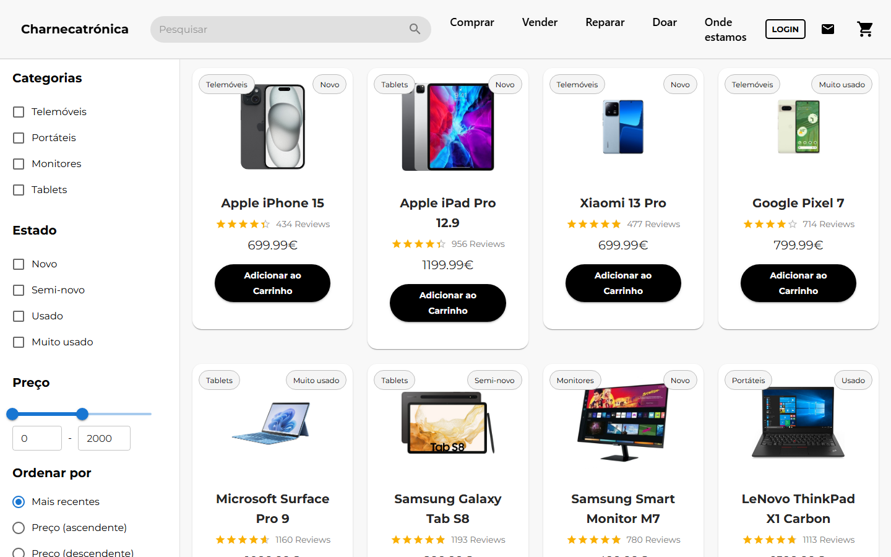
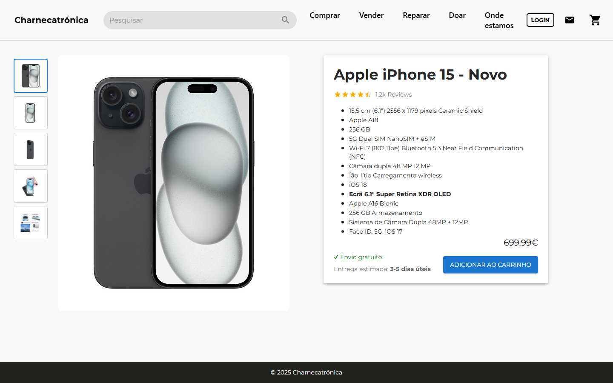
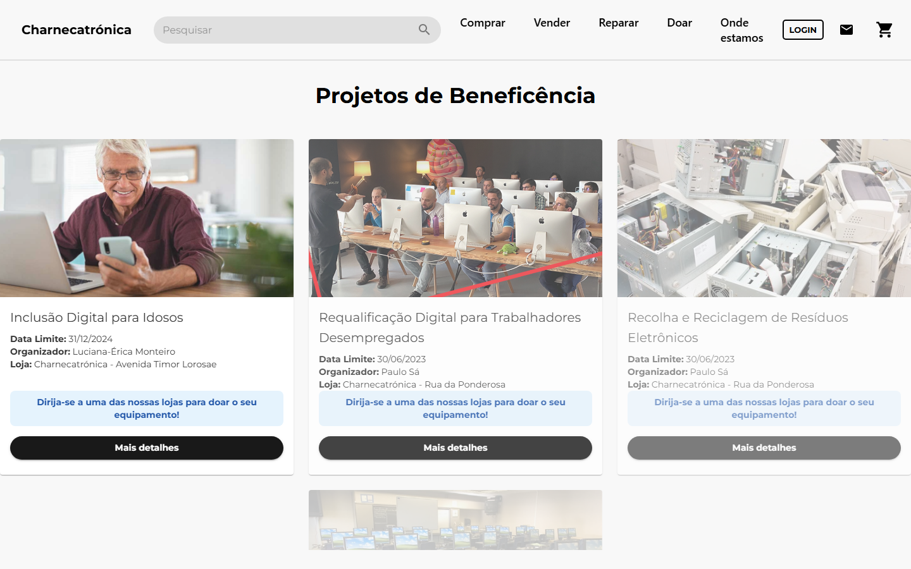
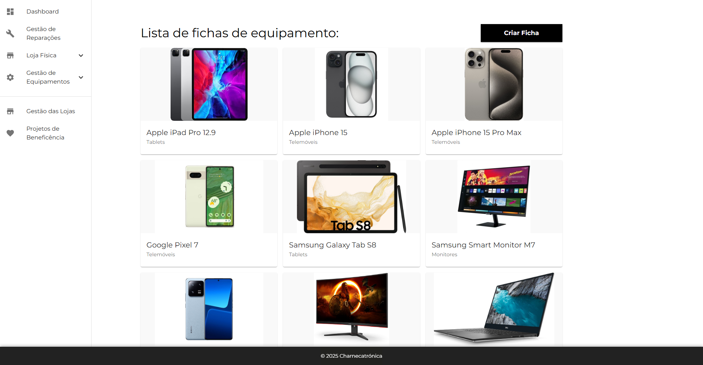

<div align="center">

# ⚡ Charnecatrónica

**Plataforma web para compra, venda, reparação e doação de equipamentos eletrónicos**


📅 **Data de entrega:** junho de 2025

| 👥 Autores — Grupo 9 |
| :---: |
| Pedro Rosa · Diogo Sousa · Guilherme Almeida |
| Francisco Lopes · Laura Santos · Tomás Nogueira |

</div>

---

## 📖 Sobre o projeto

A **Charnecatrónica** é uma aplicação web que permite a clientes e funcionários de uma rede de lojas gerir todo o ciclo de vida de equipamentos eletrónicos:

- 🛒 **Comprar** equipamentos (online, com carrinho e pagamento via Stripe, ou em loja física)
- 💰 **Vender** equipamentos usados e pedir orçamentos
- 🔧 **Reparações** — pedido, diagnóstico e acompanhamento
- ❤️ **Projetos de beneficência** — doação de equipamentos a instituições
- ⭐ **Interesses** — ser notificado quando um equipamento desejado fica disponível
- 📊 **Dashboard** para funcionários, com gestão de lojas, fichas de equipamento, vendas e compras

### 📸 Capturas de ecrã

| Página inicial | Loja |
| :---: | :---: |
|  |  |
| **Detalhes do produto** | **Projetos de beneficência** |
|  |  |

<details>
<summary>Área do funcionário: fichas de equipamento</summary>



</details>

Em produção, a aplicação foi publicada em **https://charnecatronica.pt**, numa arquitetura distribuída e tolerante a faltas no **Google Cloud**: load balancers HAProxy + Keepalived, web servers escaláveis e PostgreSQL replicado. Os detalhes estão em [docs/ARQUITETURA_GCP.md](docs/ARQUITETURA_GCP.md).

### 📚 Documentação

| Documento | Conteúdo |
| --- | --- |
| [docs/ARQUITETURA_GCP.md](docs/ARQUITETURA_GCP.md) | Infraestrutura no GCP: redes, firewall, HAProxy, Keepalived, replicação, automação, testes e como replicar |
| [docs/charnecatronica-api.yaml](docs/charnecatronica-api.yaml) | Especificação **OpenAPI 3.0** de todos os endpoints da API |
| [docs/Relatorio_4aEntrega_Grupo09.pdf](docs/Relatorio_4aEntrega_Grupo09.pdf) | Relatório de PTR: requisitos não funcionais, arquitetura e testes |
| [Relatório_PGP_final.pdf](Relatório_PGP_final.pdf) | Relatório de planeamento e gestão do projeto |

## 🗂️ Estrutura

```
Charnecatronica/
├── api/                 # Backend — Node.js + Express (porta 9000)
│   ├── controllers/     # Lógica de cada recurso
│   ├── routes/          # Definição dos endpoints
│   ├── db.js            # Ligação ao PostgreSQL
│   └── server.js        # Ponto de entrada da API
├── projeto-grupo-9/     # Frontend — React + MUI (porta 3000)
│   ├── public/
│   └── src/
│       ├── Components/
│       ├── Context/
│       └── Pages/
├── docs/                # Arquitetura GCP, especificação OpenAPI e relatório
├── db.sql               # Script de criação da base de dados
└── conf.env.example     # Modelo das variáveis de ambiente
```

## ✅ Pré-requisitos

- [Node.js](https://nodejs.org/pt) (inclui o `npm`)
- [PostgreSQL](https://www.postgresql.org/download/)
- Contas gratuitas em [Google Cloud](https://console.cloud.google.com), [Auth0](https://auth0.com) e [Stripe](https://stripe.com) (ver [passo 3](#3-obter-as-chaves-dos-serviços-externos))

Confirma a instalação no terminal:

```bash
node -v
npm -v
psql --version
```

## 🚀 Como executar

### 1. Clonar o repositório

```bash
git clone https://github.com/pedrorosa3/Charnecatronica.git
cd Charnecatronica
```

### 2. Criar a base de dados

```bash
psql -U postgres -c "CREATE DATABASE charnecatronica;"
psql -U postgres -d charnecatronica -f db.sql
```

> 💡 No Windows, se o comando `psql` não for reconhecido, usa o caminho completo
> (ex.: `"C:\Program Files\PostgreSQL\18\bin\psql.exe"`) ou adiciona essa pasta ao `PATH`.
> Também podes correr o `db.sql` pelo pgAdmin.

### 3. Obter as chaves dos serviços externos

A aplicação usa três serviços externos. Todos têm plano gratuito ou modo de teste.

<details open>
<summary><b>🗺️ Google Maps Platform (GCP)</b>: mapas das lojas e autocomplete de moradas</summary>

<br>

O projeto usa a **Maps JavaScript API** (mapas nas páginas de lojas, reparações e venda) e a **Places API** (autocomplete de moradas no checkout e na criação de lojas).

1. Entra na [Google Cloud Console](https://console.cloud.google.com) e cria um projeto novo (ex.: `charnecatronica`).
2. Ativa a faturação do projeto em **Billing** → **Link a billing account**.
   A Google pede um cartão, mas o uso em desenvolvimento cabe no crédito mensal gratuito.
3. Em **APIs & Services** → **Library**, procura e ativa:
   - ✅ **Maps JavaScript API**
   - ✅ **Places API**
   - ✅ **Geocoding API** (opcional, só usada pelo componente `MapaComEndereco`)
4. Em **APIs & Services** → **Credentials**, clica **Create credentials** → **API key** e copia a chave (começa por `AIza…`).
5. *(Recomendado)* Clica na chave para a restringir:
   - **Application restrictions** → **Websites**, e adiciona `http://localhost:3000/*` (e o domínio de produção, se existir).
   - **API restrictions** → **Restrict key**, e seleciona apenas as APIs ativadas no passo 3.
6. Guarda a chave em `REACT_APP_GOOGLE_MAPS_KEY` (ver passo 4).

> A chave é inserida automaticamente em [`projeto-grupo-9/public/index.html`](projeto-grupo-9/public/index.html) através de `%REACT_APP_GOOGLE_MAPS_KEY%`.
> **Nunca escrevas a chave diretamente no código.**

</details>

<details open>
<summary><b>🔐 Auth0</b>: login de clientes</summary>

<br>

1. Cria uma conta em [auth0.com](https://auth0.com). É criado um *tenant* (ex.: `o-teu-tenant.eu.auth0.com`).
2. Em **Applications** → **Applications** → **Create Application**, escolhe **Single Page Web Applications**.
3. No separador **Settings** da aplicação, preenche com `http://localhost:3000`:
   - **Allowed Callback URLs**
   - **Allowed Logout URLs**
   - **Allowed Web Origins**
4. Clica **Save Changes** e copia o **Domain** e o **Client ID** para `REACT_APP_AUTH_DOMAIN` e `REACT_APP_AUTH_CLIENTID`.

</details>

<details open>
<summary><b>💳 Stripe</b>: pagamentos com cartão</summary>

<br>

1. Cria uma conta em [stripe.com](https://stripe.com). Não precisas de ativar pagamentos reais.
2. Com o **Test mode** ligado, vai a **Developers** → **API keys**.
3. Copia a **Publishable key** (`pk_test_…`) para `REACT_APP_STRIPE_PK` e a **Secret key** (`sk_test_…`) para `STRIPE_SK`.
4. Para testar um pagamento, usa o cartão `4242 4242 4242 4242`, com qualquer data futura e qualquer CVC.

</details>

### 4. Configurar as variáveis de ambiente

Copia o ficheiro [conf.env.example](conf.env.example) para `.env` e preenche os valores:

| Variável | Onde obter | Exemplo |
| --- | --- | --- |
| `DB_HOST` | PostgreSQL local | `localhost` |
| `DB_PORT` | PostgreSQL local | `5432` |
| `DB_USER` | PostgreSQL local | `postgres` |
| `DB_PASSWORD` | Password definida ao instalar o PostgreSQL | `********` |
| `DB_NAME` | Nome da BD criada no passo 2 | `charnecatronica` |
| `REACT_APP_GOOGLE_MAPS_KEY` | Google Cloud → Credentials | `AIza…` |
| `REACT_APP_AUTH_DOMAIN` | Auth0 → Application → Settings | `o-teu-tenant.eu.auth0.com` |
| `REACT_APP_AUTH_CLIENTID` | Auth0 → Application → Settings | `aBcD1234…` |
| `REACT_APP_STRIPE_PK` | Stripe → Developers → API keys | `pk_test_…` |
| `STRIPE_SK` | Stripe → Developers → API keys | `sk_test_…` |
| `REACT_APP_URL_HOST` | Endereço da API | `http://localhost:9000` |

> ⚠️ O ficheiro `.env` é lido em três sítios diferentes, por isso deve existir uma cópia em cada um:
> na **raiz** do projeto, em **`api/`** e em **`projeto-grupo-9/`**.

```bash
cp conf.env.example .env
cp conf.env.example api/.env
cp conf.env.example projeto-grupo-9/.env
```

> 🔒 Os ficheiros `.env` estão no `.gitignore`. **Nunca façam commit das chaves.**
> Se alterares o `.env` com o frontend a correr, reinicia o `npm start` para as alterações terem efeito.

### 5. Iniciar o backend (API)

```bash
cd api
npm install
npm start
```

A API fica disponível em **http://localhost:9000**.

### 6. Iniciar o frontend

Num **novo terminal**:

```bash
cd projeto-grupo-9
npm install
npm start
```

A aplicação abre automaticamente em **http://localhost:3000** 🎉

> 💡 Sempre que guardares um ficheiro, a página atualiza sozinha. Só precisas de voltar a correr `npm start` se fechares o terminal.

## 🔑 Contas de teste

| Área | Como entrar |
| --- | --- |
| **Cliente** | Botão **LOGIN** no topo da página. Cria uma conta ou entra pelo Auth0 (Google, email, …). O perfil é criado automaticamente na base de dados no primeiro login. |
| **Funcionário** | Vai a **http://localhost:3000/loginempregado** e entra com o número interno `2` e a password `yMv(x1v7^8fB` (a funcionária fictícia Helena Esteves, do `db.sql`). Abre o **Dashboard**, com reparações, loja física, fichas de equipamento, lojas e projetos. |
| **Administrador** | Número interno `admin` (ou `0000`) e password `admin`. Entra, mas o cartão de dados do Dashboard fica vazio, porque `admin` não existe na tabela `empregado`. Os menus laterais funcionam na mesma. |

> ⚠️ **Projeto académico, só para demonstração.** O login de administrador está escrito diretamente no código ([loginEmpregadoController.js](api/controllers/loginEmpregadoController.js)), e os dados de exemplo do `db.sql` (pessoas, emails e passwords) são fictícios e estão guardados em texto simples. Não uses esta configuração com dados reais.

## 🛠️ Scripts úteis

| Pasta | Comando | Descrição |
| --- | --- | --- |
| `api/` | `npm start` | Inicia o servidor Express |
| `projeto-grupo-9/` | `npm start` | Inicia o React em modo de desenvolvimento |
| `projeto-grupo-9/` | `npm run build` | Gera a versão de produção em `build/` |
| `projeto-grupo-9/` | `npm test` | Corre os testes unitários (Jest + Testing Library) |

## 📑 Documentação da API

A especificação completa (OpenAPI 3.0) está em [docs/charnecatronica-api.yaml](docs/charnecatronica-api.yaml).
Para explorar e testar os endpoints:

1. Abre o [Swagger Editor](https://editor.swagger.io/).
2. Em **File** → **Import file**, escolhe o `charnecatronica-api.yaml`.
3. Com a API a correr localmente (`http://localhost:9000`), usa **Try it out** em cada endpoint.

## ☁️ Arquitetura em produção (GCP)

Para a entrega final, a aplicação foi publicada no **Google Cloud (Compute Engine)** em **https://charnecatronica.pt**:

```
                  Cliente ── HTTPS 443 ──▶ charnecatronica.pt (34.29.89.147, IP flutuante)
                                                     │
                       ┌─────────────────────────────┴─────────────────────────────┐
                       ▼                         VRRP (Keepalived)                 ▼
              LoadBalancer 1 (ativo)  ◀──────────────────────────▶  LoadBalancer 2 (standby)
              HAProxy · TLS (certbot)                                HAProxy · TLS
                       │                                                     │
                       └───────────────┬───────── HTTP 80 ───────────────────┘
                                       ▼
                  Web server 1 … N  (Apache · React :3000 · Express :9000)
                  criados por script · .env vindo do Cloud Storage
                                       │ TCP 5432
                                       ▼
                  PostgreSQL 17 primária  ◀── replicação + VRRP ──▶  PostgreSQL 17 réplica
```

- **Load balancers:** HAProxy faz a terminação TLS e distribui a carga. O Keepalived (VRRP) passa o IP público para o standby se o ativo falhar.
- **Escalabilidade:** um script cria web servers novos já configurados, e um *cron* a cada minuto atualiza o `haproxy.cfg` com os web servers ativos.
- **Base de dados:** PostgreSQL replicado, com failover automático do IP interno.
- **Segurança:** HTTPS com Let's Encrypt, domínio próprio, duas redes VPC (`ptr` externa e `default` interna), regras de firewall mínimas e credenciais guardadas num bucket do Cloud Storage.
- **Testes:** failover, carga (Locust), vulnerabilidades (Nmap, OWASP ZAP) e aceitação da API (Swagger).

👉 Os detalhes completos e o guia para replicar a infraestrutura estão em **[docs/ARQUITETURA_GCP.md](docs/ARQUITETURA_GCP.md)**.

## ❓ Problemas comuns

- **`npm` não é reconhecido** → reinstala o Node.js e reabre o terminal.
- **Erro de ligação à base de dados** → confirma que o PostgreSQL está a correr e que os dados no `.env` estão corretos.
- **Porta 3000 ou 9000 ocupada** → fecha o processo que a está a usar ou aceita a porta alternativa que o React sugere.
- **Mapa cinzento com "This page can't load Google Maps correctly"** → a chave do Google Maps está errada, a faturação não está ativa ou as APIs não foram ativadas (ver [passo 3](#3-obter-as-chaves-dos-serviços-externos)). A consola do browser (F12) mostra o erro exato, por exemplo `ApiNotActivatedMapError` ou `RefererNotAllowedMapError`.
- **Erro "Callback URL mismatch" no login** → falta `http://localhost:3000` nos URLs permitidos da aplicação Auth0.
- **Alterei o `.env` mas nada mudou** → reinicia o `npm start`, porque as variáveis `REACT_APP_*` só são lidas no arranque.

---

<div align="center">

Feito com ❤️ pelo **Grupo 9** · Distribuído sob a licença [MIT](LICENSE)

</div>
