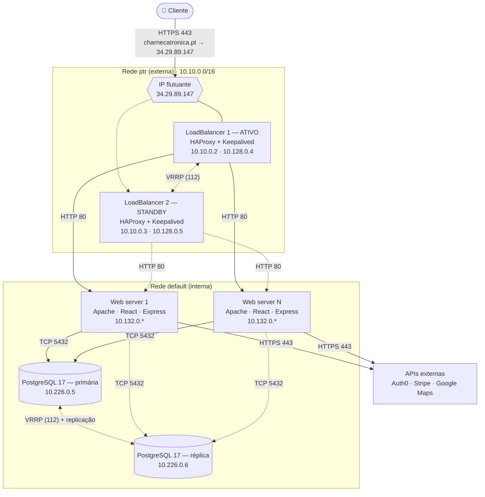

# ☁️ Arquitetura em produção — Google Cloud Platform

> Infraestrutura usada para publicar a Charnecatrónica em **https://charnecatronica.pt**, no âmbito da unidade curricular
> **Projeto de Tecnologias de Redes (PTR), LTI/FCUL 2024/25**, com entrega em junho de 2025.
>
> Fonte principal: [Relatório da 4ª entrega](Relatorio_4aEntrega_Grupo09.pdf) (secções 2.1 a 2.17).

> [!IMPORTANT]
> Os ficheiros de configuração das VMs (`haproxy.cfg`, `keepalived.conf`, `takeover.sh`, `atualiza-haproxy.sh`,
> `create_new_web_server.sh`, `setup.sh`, …) **existiam apenas nas máquinas do GCP e não foram guardados no repositório**.
> Este documento descreve o que cada um fazia. Os excertos de configuração na secção
> [Como replicar](#-como-replicar) são **exemplos de referência reconstruídos** e não os ficheiros originais.

---

## 📐 Visão geral



| Camada | Instâncias | Software | Função |
| --- | --- | --- | --- |
| **Load balancers** | 2 (ativo + passivo) | HAProxy, Keepalived, certbot | Terminação TLS, distribuição de carga e failover do IP público |
| **Web servers** | N (escalável) | Apache, Node.js, React, Express | Servem o frontend (porta 3000) e a API (porta 9000) |
| **Base de dados** | 2 (primária + réplica) | PostgreSQL 17, HAProxy, Keepalived | Dados replicados e failover do IP interno |

---

## 🌐 Rede, IPs e DNS

### Redes VPC

| Rede | Tipo | Gama | Interface nas VMs | Quem está ligado |
| --- | --- | --- | --- | --- |
| `ptr` | Externa | `10.10.0.0/16` (gateway `10.10.0.1`) | `ens5` | Load balancers |
| `default` | Interna | Sub-redes regionais (`10.128.0.0/20`, `10.132.0.0/20`, `10.226.0.0/20`) | `ens4` | Load balancers, web servers e BDs |

Os load balancers têm **duas interfaces**, uma em cada rede. Nos web servers e nas BDs só há uma, na rede `default`.

### Endereços

| Recurso | Endereço |
| --- | --- |
| IP externo estático (flutuante) | `34.29.89.147` |
| LoadBalancer 1 (ativo) | `10.10.0.2` (ptr) · `10.128.0.4` (default) |
| LoadBalancer 2 (standby) | `10.10.0.3` (ptr) · `10.128.0.5` (default) |
| Web servers | `10.132.0.*` (atribuídos dinamicamente) |
| BD 1 / BD 2 | `10.226.0.5` / `10.226.0.6` |

### Domínio

- Domínio **`charnecatronica.pt`**, registado em [dominios.pt](https://www.dominios.pt).
- No gestor de DNS do dominios.pt foi criado um **registo A** `charnecatronica.pt → 34.29.89.147`.

### Encaminhamento de resposta (policy routing)

Como os load balancers têm duas interfaces, as respostas ao tráfego que entra pela rede `ptr` tinham de sair pela mesma interface (`ens5`).
Para isso foi criada uma tabela de encaminhamento `ext` (id 200), configurada no arranque pelo `route-setup.sh`, que é executado pelo serviço systemd `route-setup.service`:

```bash
echo "200 ext" | sudo tee -a /etc/iproute2/rt_tables
sudo ip rule add from 10.10.0.2 lookup ext            # 10.10.0.3 no LB2
sudo ip route add default via 10.10.0.1 dev ens5 table ext
```

---

## 🔥 Regras de firewall

| Regra | Rede | Direção | Origem | Protocolos/portas | Objetivo |
| --- | --- | --- | --- | --- | --- |
| `ptr-allow-https` | ptr | Entrada | `0.0.0.0/0` | `tcp:443` | HTTPS dos clientes para os LBs |
| `ptr-allow-vrrp` | ptr | Entrada | `10.10.0.0/16` | VRRP (`112`) | Heartbeat Keepalived entre LBs |
| `default-allow-http` | default | Entrada | `0.0.0.0/0` | `tcp:80` | LBs → web servers |
| `default-allow-frontend-api` | default | Entrada | `0.0.0.0/0` | `tcp:3000,9000` | Frontend React e API Express |
| `allow-postgresql` | default | Entrada | `10.128.0.0/20` | `tcp:5432` | Web servers → BDs |
| `allow-bd-vrrp` / `allow-vrrp-multicast` | default | Entrada | gama das BDs | VRRP (`112`) | Heartbeat Keepalived entre BDs |
| `allow-ssh` | default | Entrada | — | `tcp:22` | Administração por SSH |
| `allow-saida-stripe-https` | default | Saída | `0.0.0.0/0` | `tcp:443` | Saída para Auth0, Stripe e Google Maps |

> 💡 O VRRP é o **protocolo IP 112** e não uma porta TCP. No GCP, a regra deve usar `--allow=112` (ou `vrrp`) e não `tcp:112`.

---

## ⚖️ Load balancers (HAProxy + Keepalived)

**HAProxy**, em `/etc/haproxy/haproxy.cfg`:
- `frontend` em `:443`, com o certificado `/etc/ssl/private/haproxy.pem`, que faz a terminação TLS;
- `backend` com os web servers ativos na porta 80, com *health checks*;
- a lista de servidores do backend é **reescrita automaticamente a cada minuto** (ver [Automação](#-automação)).

**Keepalived**, em `/etc/keepalived/keepalived.conf`, funciona em modo **ativo-passivo**:
- o LB1 é `MASTER` e o LB2 é `BACKUP`, e trocam anúncios VRRP;
- se o LB1 falhar, o LB2 executa o `/etc/keepalived/takeover.sh` (com registo em `/etc/keepalived/takeover.log`), que usa o `gcloud` para **mover o IP externo 34.29.89.147** para si;
- quando o LB1 recupera, volta a ficar com o IP.

**TLS:**
1. O certificado Let's Encrypt foi gerado com o **certbot** no LB1 para `charnecatronica.pt`.
2. O `fullchain` e a `privkey` foram juntos num único ficheiro, `haproxy.pem`.
3. O ficheiro foi copiado para o LB2 por SSH (`scp`), e o `haproxy.cfg` de ambos foi configurado para o usar.

---

## 🖥️ Web servers

Cada web server é criado pelo script **`create_new_web_server.sh`**, executado no Cloud Shell ou com o `gcloud`. Esse script:

1. Cria uma VM nova na rede `default`, com o *startup script* **`setup.sh`**.
2. O `setup.sh` instala o **Apache**, o **git** e o **Node.js**, e clona o projeto do GitHub.
3. Copia o ficheiro **`.env`** de um bucket do **Cloud Storage** para a raiz do projeto e para `projeto-grupo-9/`, por isso as credenciais nunca vão para o repositório.
4. Corre `npm install` na API e no frontend.
5. Cria dois serviços systemd que arrancam a aplicação sempre que a VM liga:

| Serviço | Script | Comando |
| --- | --- | --- |
| `api.service` | `/usr/local/bin/start-api.sh` | `npm run start` em `api/` (porta 9000) |
| `frontend.service` | `/usr/local/bin/start-frontend.sh` | `npm run start` em `projeto-grupo-9/` (porta 3000) |

O Apache, em `/etc/apache2/sites-available/000-default.conf`, escuta na porta 80 e recebe o tráfego vindo dos load balancers.

Poucos segundos depois de a VM ficar `RUNNING`, o script dos load balancers deteta-a e acrescenta-a ao `haproxy.cfg`.

---

## 🗄️ Base de dados (PostgreSQL 17 replicado)

- Há duas VMs com **PostgreSQL 17**: `10.226.0.5` (primária) e `10.226.0.6` (réplica).
- A **replicação** entre as duas mantém os dados iguais: um `DELETE` numa aparece no `SELECT` da outra.
- Usam **Keepalived + HAProxy**, com o mesmo mecanismo dos load balancers. Um script de verificação (`check_pg.sh`, com `pg_isready`) faz o IP interno passar para a outra BD se o PostgreSQL ou a VM primária falharem.
- Ficheiros de configuração: `/etc/postgresql/17/main/postgresql.conf` (com `listen_addresses`) e `/etc/postgresql/17/main/pg_hba.conf` (com acesso a partir da rede dos web servers).
- Os web servers ligam-se através das variáveis `DB_HOST` e `DB_PORT=5432` do `.env`.

---

## 🤖 Automação

| Onde | O quê | Quando |
| --- | --- | --- |
| LB1 e LB2 | `/usr/local/bin/atualiza-haproxy.sh`: consulta com o `gcloud` os web servers `RUNNING`, reescreve o backend do `haproxy.cfg` e recarrega o HAProxy. Regista em `/var/log/atualizar_lb.log`. | `cron`, a cada minuto (`* * * * *`) |
| LB1 e LB2 | `route-setup.service`: aplica o *policy routing* da rede `ptr` | No arranque |
| Cloud Shell | `create_new_web_server.sh`: cria um web server novo | Manual (escalar) |
| Web servers | `api.service` e `frontend.service` | No arranque |

---

## 🧪 Testes realizados

| Teste | Como | Resultado esperado |
| --- | --- | --- |
| **Failover dos LBs** | `sudo systemctl stop keepalived` no LB1, e depois `restart` | O IP 34.29.89.147 passa para o LB2 e volta para o LB1 (`ip a \| grep 34.29.89.147`) |
| **Falha de um web server** | Desligar uma VM de web server | Em menos de 1 minuto deixa de aparecer no `haproxy.cfg` dos dois LBs |
| **Escalar** | Correr o `create_new_web_server.sh` | A VM nova é adicionada automaticamente aos dois LBs |
| **Failover da BD** | `sudo systemctl stop keepalived` / `stop postgresql` na BD primária | O IP interno passa para a réplica (`ip addr show ens4`) |
| **Replicação** | `DELETE` numa BD e `SELECT` na outra | Os dados são iguais nas duas |
| **Carga** | [Locust](https://locust.io): `python -m locust -f locustfile.py --host https://charnecatronica.pt/` | 20 utilizadores durante 15 min, com cerca de 2% de falhas |
| **Vulnerabilidades** | `nmap -Pn -sS -sV`, `nmap --script vuln` e OWASP ZAP (AJAX Spider) | Só alertas de risco médio (ver relatório, secção 2.17) |
| **Aceitação da API** | [Swagger Editor](https://editor.swagger.io/) com o ficheiro [charnecatronica-api.yaml](charnecatronica-api.yaml) | Todos os endpoints respondem |

---

## 🔁 Como replicar

> Os comandos abaixo usam o `gcloud` e são um **guia de referência**. Ajusta a região, os nomes e as gamas de IPs ao teu projeto.

### 1. Redes, IP estático e firewall

```bash
REGION=us-central1; ZONE=us-central1-a

# Rede externa para os load balancers
gcloud compute networks create ptr --subnet-mode=custom
gcloud compute networks subnets create ptr-subnet --network=ptr --region=$REGION --range=10.10.0.0/16

# IP externo estático (passa a ser o IP flutuante)
gcloud compute addresses create charnecatronica-ip --region=$REGION

# Firewall
gcloud compute firewall-rules create ptr-allow-https  --network=ptr --allow=tcp:443
gcloud compute firewall-rules create ptr-allow-vrrp   --network=ptr --allow=112 --source-ranges=10.10.0.0/16
gcloud compute firewall-rules create default-allow-http --network=default --allow=tcp:80
gcloud compute firewall-rules create allow-postgresql --network=default --allow=tcp:5432 --source-ranges=10.128.0.0/9
gcloud compute firewall-rules create allow-bd-vrrp    --network=default --allow=112 --source-ranges=10.226.0.0/20
```

### 2. Load balancers (×2)

```bash
gcloud compute instances create lb1 --zone=$ZONE --machine-type=e2-small \
  --network-interface=network=default,private-network-ip=10.128.0.4,no-address \
  --network-interface=subnet=ptr-subnet,private-network-ip=10.10.0.2,address=charnecatronica-ip \
  --scopes=compute-rw --image-family=ubuntu-2204-lts --image-project=ubuntu-os-cloud
# lb2: o mesmo, com 10.128.0.5 / 10.10.0.3 e sem "address=" (fica sem IP externo)

# Em cada LB:
sudo apt update && sudo apt install -y haproxy keepalived certbot
```

<details>
<summary><b>Exemplo de <code>/etc/keepalived/keepalived.conf</code> (LB1)</b></summary>

```conf
vrrp_script chk_haproxy {
    script "/usr/bin/pgrep haproxy"
    interval 2
}

vrrp_instance VI_1 {
    state MASTER              # BACKUP no LB2
    interface ens5
    virtual_router_id 51
    priority 101              # 100 no LB2
    advert_int 1
    unicast_src_ip 10.10.0.2  # o GCP não suporta multicast, por isso usa-se unicast
    unicast_peer {
        10.10.0.3
    }
    track_script {
        chk_haproxy
    }
    notify_master /etc/keepalived/takeover.sh
}
```
</details>

<details>
<summary><b>Exemplo de <code>/etc/keepalived/takeover.sh</code></b>: move o IP externo para este LB</summary>

```bash
#!/bin/bash
# Executado pelo Keepalived quando este LB passa a MASTER
ME=$(hostname); OTHER=$([ "$ME" = "lb1" ] && echo lb2 || echo lb1)
ZONE=us-central1-a; IP=34.29.89.147; NIC=nic1   # nic1 = interface na rede ptr
{
  echo "$(date) $ME a assumir $IP"
  gcloud compute instances delete-access-config "$OTHER" --zone=$ZONE --network-interface=$NIC --access-config-name="external-nat" || true
  gcloud compute instances add-access-config    "$ME"    --zone=$ZONE --network-interface=$NIC --access-config-name="external-nat" --address=$IP
} >> /etc/keepalived/takeover.log 2>&1
```
</details>

<details>
<summary><b>Exemplo de <code>/etc/haproxy/haproxy.cfg</code></b></summary>

```conf
frontend https_in
    bind *:443 ssl crt /etc/ssl/private/haproxy.pem
    bind *:80
    http-request redirect scheme https unless { ssl_fc }
    default_backend webservers

backend webservers
    balance roundrobin
    option httpchk GET /
    # Bloco gerado automaticamente pelo atualiza-haproxy.sh
    server web-1 10.132.0.2:80 check
    server web-2 10.132.0.3:80 check
```
</details>

<details>
<summary><b>Exemplo de <code>/usr/local/bin/atualiza-haproxy.sh</code></b> (cron a cada minuto)</summary>

```bash
#!/bin/bash
CFG=/etc/haproxy/haproxy.cfg
SERVERS=$(gcloud compute instances list --filter="name~^web AND status=RUNNING" \
          --format="value(name,networkInterfaces[0].networkIP)" \
          | awk '{printf "    server %s %s:80 check\n", $1, $2}')
NEW=$(sed '/^backend webservers/,$d' "$CFG"; printf 'backend webservers\n    balance roundrobin\n    option httpchk GET /\n%s\n' "$SERVERS")
if [ "$NEW" != "$(cat $CFG)" ]; then
  echo "$NEW" > "$CFG" && systemctl reload haproxy
  echo "$(date) backend atualizado:" >> /var/log/atualizar_lb.log; echo "$SERVERS" >> /var/log/atualizar_lb.log
fi
```

```bash
# crontab -e (root)
* * * * * /usr/local/bin/atualiza-haproxy.sh
```
</details>

**Certificado TLS (LB1):**

```bash
sudo certbot certonly --standalone -d charnecatronica.pt   # parar o haproxy durante a emissão
sudo bash -c 'cat /etc/letsencrypt/live/charnecatronica.pt/{fullchain,privkey}.pem > /etc/ssl/private/haproxy.pem'
scp /etc/ssl/private/haproxy.pem lb2:/tmp/ && ssh lb2 'sudo mv /tmp/haproxy.pem /etc/ssl/private/'
```

### 3. Bucket com o `.env`

```bash
gcloud storage buckets create gs://charnecatronica-config --location=$REGION
gcloud storage cp .env gs://charnecatronica-config/.env
```

### 4. Web servers

<details>
<summary><b>Exemplo de <code>setup.sh</code></b> (startup script)</summary>

```bash
#!/bin/bash
apt update && apt install -y apache2 git curl
curl -fsSL https://deb.nodesource.com/setup_20.x | bash - && apt install -y nodejs

cd /opt && git clone https://github.com/pedrorosa3/Charnecatronica.git app && cd app
gcloud storage cp gs://charnecatronica-config/.env .env
cp .env api/.env && cp .env projeto-grupo-9/.env
(cd api && npm install) && (cd projeto-grupo-9 && npm install)

# Apache como reverse proxy: / → React (3000)
a2enmod proxy proxy_http
cat > /etc/apache2/sites-available/000-default.conf <<'EOF'
<VirtualHost *:80>
    ProxyPreserveHost On
    ProxyPass        / http://localhost:3000/
    ProxyPassReverse / http://localhost:3000/
</VirtualHost>
EOF
systemctl restart apache2

for s in api frontend; do
  dir=$([ $s = api ] && echo api || echo projeto-grupo-9)
  cat > /etc/systemd/system/$s.service <<EOF
[Unit]
After=network.target
[Service]
WorkingDirectory=/opt/app/$dir
ExecStart=/usr/bin/npm run start
Restart=always
Environment=BROWSER=none
[Install]
WantedBy=multi-user.target
EOF
done
systemctl daemon-reload && systemctl enable --now api frontend
```
</details>

```bash
# create_new_web_server.sh
NAME=web-$(date +%s)
gcloud compute instances create $NAME --zone=$ZONE --machine-type=e2-medium \
  --network=default --scopes=storage-ro \
  --image-family=ubuntu-2204-lts --image-project=ubuntu-os-cloud \
  --metadata-from-file=startup-script=setup.sh
```

### 5. Base de dados (×2)

```bash
sudo apt install -y postgresql-17 keepalived haproxy
# postgresql.conf: listen_addresses = '*'
# pg_hba.conf:     host all all 10.128.0.0/9 scram-sha-256
#                  host replication replicator 10.226.0.0/20 scram-sha-256
# Na réplica: pg_basebackup -h 10.226.0.5 -U replicator -D /var/lib/postgresql/17/main -R
psql -U postgres -c "CREATE DATABASE charnecatronica;" && psql -U postgres -d charnecatronica -f db.sql
```

### 6. DNS

No gestor de DNS do registador, cria um **registo A**: `charnecatronica.pt → <IP estático>`.

---

## 🛠️ Comandos úteis de diagnóstico

```bash
# Load balancers
sudo systemctl restart haproxy keepalived
sudo cat /etc/keepalived/takeover.log
ip a | grep 34.29.89.147                    # quem tem o IP flutuante?
ip rule list && ip route show table ext     # policy routing
curl -v --interface ens5 https://charnecatronica.pt/
sudo tail -f /var/log/atualizar_lb.log
grep CRON /var/log/syslog | tail -20

# Web servers
sudo systemctl status api frontend
curl http://localhost:9000/equipamentos

# Base de dados
psql -h 10.226.0.6 -U postgres -d charnecatronica
sudo ss -ltnp | grep 5432
ip addr show ens4                           # quem tem o IP interno flutuante?
```

---

## 📝 Notas e melhorias possíveis

- **Guardar as configurações no repositório:** pôr os ficheiros numa pasta `deploy/`, sem segredos, para que a infraestrutura possa ser recriada.
- **Frontend em produção:** servir o resultado do `npm run build` pelo Apache, em vez do servidor de desenvolvimento (`npm start`). É mais rápido e evita expor a porta 3000.
- **Regra `default-allow-frontend-api`:** abre as portas 3000 e 9000 a `0.0.0.0/0`. Deve ser limitada à gama interna dos load balancers.
- **Apache:** o nmap detetou a CVE-2011-3192 (byterange DoS). Atualizar o Apache ou desativar os pedidos com vários intervalos (`Range`).
